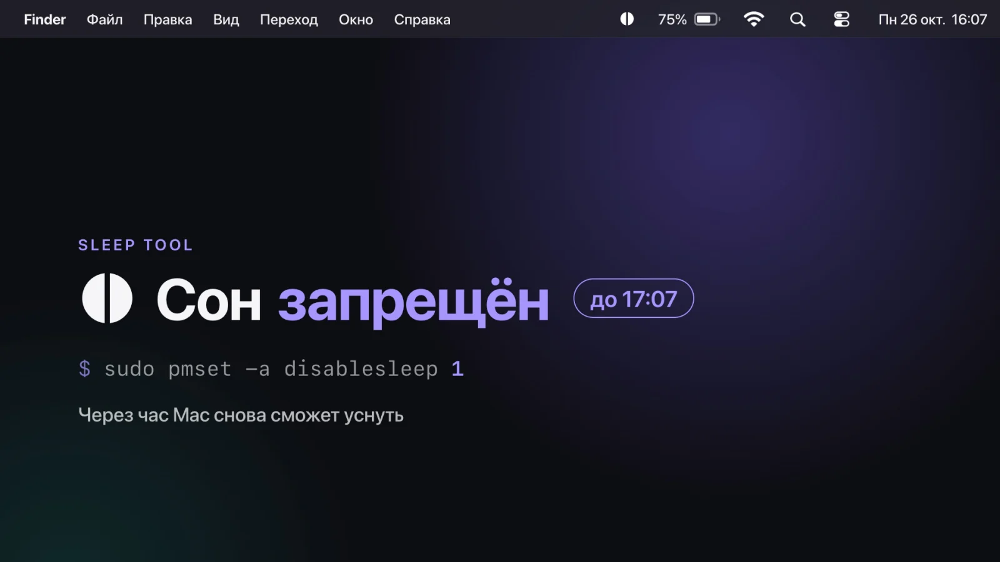
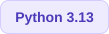
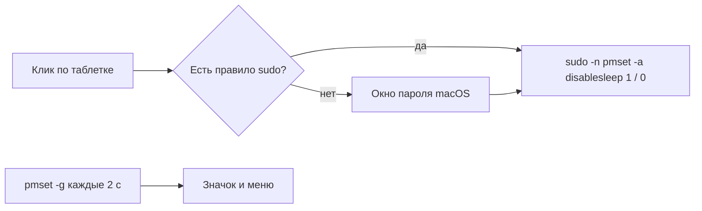

# Sleep Tool

[](media/sleep-tool.mp4)

<!-- ВИДЕО: открой README в редакторе GitHub, перетащи сюда media/sleep-tool.mp4, и GitHub вставит на это место ссылку на ролик -->

Таблетка в строке меню macOS, которая одной кнопкой включает и выключает запрет сна. Под капотом одна команда: `sudo pmset -a disablesleep 1` и обратно `0`. Пока сон запрещён, Mac не засыпает совсем, даже с закрытой крышкой.

     

> [!IMPORTANT]
> **Это системный флаг, а не «кофеин» на время работы приложения.** `disablesleep` держится, пока его не выключат: из меню, из терминала или таймером. Даже если закрыть Sleep Tool, бессрочный запрет останется. Mac с запрещённым сном и закрытой крышкой продолжает работать: в рюкзаке он может перегреться.

> [!TIP]
> **Поставить за минуту**
>
> ```bash
> git clone https://github.com/DverkuOff/sleep-tool.git
> cd sleep-tool
> ./install.sh
> ```
>
> В строке меню появится таблетка. Нажми на неё, затем «Не спрашивать пароль»: один раз введёшь пароль, и дальше сон переключается одним кликом.

## Значок

| Значок | Что значит | `pmset -g` |
| :---: | --- | --- |
|  | Сон разрешён, Mac засыпает как обычно | `SleepDisabled 0` |
|  | Сон запрещён, Mac не уснёт даже с закрытой крышкой | `SleepDisabled 1` |

Таблетка повторяет значок [Amphetamine](https://apps.apple.com/app/amphetamine/id937984704): размеры сняты с его иконки в строке меню и перерисованы в вектор. Состояние Sleep Tool читает из `pmset -g` каждые 2 секунды, поэтому значок покажет и изменение, сделанное из терминала.

## Меню

| Пункт | Что делает |
| --- | --- |
| Сон разрешён / Сон запрещён | Текущее состояние. С таймером: «Сон запрещён до 17:07 (ещё 1 ч)» |
| Запретить сон / Разрешить сон | `pmset -a disablesleep 1` или `0` |
| Запретить на время | 15 минут, 30 минут, 1 час, 2 часа, 5 часов. Потом сон снова разрешается сам |
| Запускать при входе | Автозапуск после входа в систему через агент launchd |
| Не спрашивать пароль | Правило sudo, которое разрешает без пароля только эти две команды. Повторный клик убирает правило |
| Выход | Закрывает Sleep Tool. Запрет на время снимается, бессрочный остаётся как есть |

## Установка

Нужны macOS и Python 3. Проверено на macOS 26 Tahoe и Python 3.13. [uv](https://docs.astral.sh/uv/) необязателен: без него установщик возьмёт `python3 -m venv` и pip.

```bash
./install.sh
```

Что делает установщик:

1. Ставит PyObjC в `.venv` рядом с кодом.
2. Регистрирует агент launchd `~/Library/LaunchAgents/com.chill.sleep-tool.plist`. Он запускает Sleep Tool при входе в систему и поднимает снова, если приложение упало.
3. Собирает `~/Applications/Sleep Tool.app`, чтобы запускать из Spotlight.
4. Запускает приложение и печатает, где встала иконка.

Код работает прямо из папки репозитория, поэтому после установки её не переносят. Переехала папка: снова `./install.sh`.

## Пароль

`pmset -a disablesleep` работает только от root. Режимов два:

- **По умолчанию** каждое переключение показывает системное окно пароля (`osascript … with administrator privileges`). Пароль нигде не сохраняется.
- **«Не спрашивать пароль»** один раз просит пароль и кладёт в `/etc/sudoers.d/sleep-tool` правило:

  ```
  <пользователь> ALL=(root) NOPASSWD: /usr/bin/pmset -a disablesleep 0, /usr/bin/pmset -a disablesleep 1
  ```

  Без пароля разрешены только эти две команды. Перед установкой правило проверяется через `visudo -c`.

Таймеру «Запретить на время» нужен второй режим: иначе по истечении времени macOS спросит пароль, и, если тебя нет рядом, сон так и останется запрещён.

## Как устроено



| Файл | Что внутри |
| --- | --- |
| `sleep_tool.py` | Всё приложение: значок, меню, таймер, вызовы `pmset` |
| `icons/on.pdf`, `icons/off.pdf` | Значки для строки меню: вектор, template-картинки под светлую и тёмную тему |
| `install.sh` | Установка: окружение, агент launchd, `Sleep Tool.app` |
| `media/anim/` | Исходник видео на HyperFrames |
| `~/Library/Logs/sleep-tool.log` | Лог: запуск, где встала иконка, каждое переключение |

Две особенности macOS 26, из-за которых код устроен именно так:

- **PyObjC напрямую, без rumps.** С библиотекой rumps macOS 26 молча не давала иконке места в строке меню, а иконка, созданная через AppKit напрямую, показывается.
- **Python запускает launchd, а не скрипт внутри `.app`.** Иначе macOS не понимает, чьё это приложение, и тоже прячет иконку. Поэтому `Sleep Tool.app` только просит launchd поднять агент.

## Удаление

```bash
launchctl bootout gui/$(id -u)/com.chill.sleep-tool
rm -f ~/Library/LaunchAgents/com.chill.sleep-tool.plist
rm -rf ~/Applications/"Sleep Tool.app" ~/Library/"Application Support"/sleep-tool ~/Library/Logs/sleep-tool.log
sudo rm -f /etc/sudoers.d/sleep-tool
sudo pmset -a disablesleep 0
```

## Видео

Ролик собран в [HyperFrames](https://hyperframes.heygen.com): HTML и GSAP, которые рендерятся в mp4 кадр за кадром. Исходник лежит в `media/anim`, готовый файл в `media/sleep-tool.mp4`.

Курсор, значки строки меню (SF Symbols) и шрифты SF настоящие, из macOS. В репозиторий они не входят: перед рендером их выгружает из системы `tools/export_mac_assets.py`.

```bash
.venv/bin/python media/anim/tools/export_mac_assets.py   # курсор, SF Symbols и шрифты SF из macOS
cd media/anim
npx hyperframes@0.8.192 preview      # открыть в браузере и поправить
npx hyperframes@0.8.192 render --quality delivery --output ../sleep-tool.mp4
```
